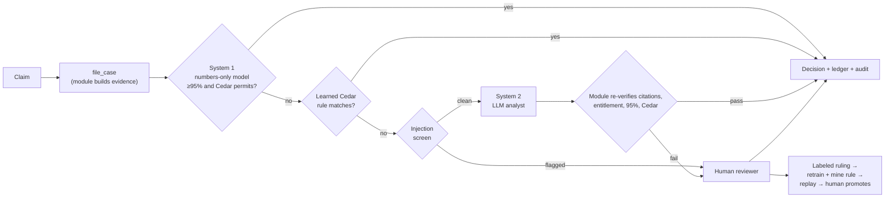

<p align="center">
  
  <br />
  
</p>

<p align="center">
  <strong>An AI dispute analyst and credit approver for satellite ground-station operators.</strong>
</p>

It decides SLA credit claims from the evidence, decides alone only when it is at least 95% confident and Cedar policy allows it, asks a human otherwise, and turns each human ruling into tested, versioned policy.

Built at Cal Hacks 2026 by Aamir Abatiyow, for **Hyphenate**, **SpacetimeDB**, and **SpaceX**.

Live demo: [cal-hacks26.vercel.app](https://cal-hacks26.vercel.app) · Full detail: [docs/REFERENCE.md](docs/REFERENCE.md)

## The problem

Ground-station networks bill every satellite pass by the minute. When a pass drops or degrades, the customer files an SLA credit claim, and someone has to work out what happened, whether the contract excuses it, and what is owed. We model an operator on **KSAT** (28 stations, ~2.1M contacts a year per its 2025 annual report) and price contacts at **AWS Ground Station** on-demand rates ($15/min narrowband, $25/min wideband).

On a fresh seed with 30 days of pass history, the system computes these figures live from the ledger:

| Billed | Credits paid | Revenue at risk | Leakage avoided | Review cost saved |
|---|---|---|---|---|
| $80.6M | $2.67M | $2.77M | $3.54M | $411K |

That is about **$65M a year** in credits plus revenue at risk.

**Why automate, and why not just pay?** A human review is modeled at **$300** and an automated decision at **$15**. Many single-contact claims are worth less than the review, so reviewing every claim by hand costs more than paying it. But paying every claim leaks money: the $3.54M "leakage avoided" is recoveries, denied claims and the unpaid part of over-claims that blind payment would have lost. Automation decides what it can prove for $15, pays only the contract entitlement, and sends the rest to a person. On this seed, 1,442 decisions were auto-approved, saving $285 each.

**Seats it fills:** accounts-receivable dispute analyst plus billing credit approver.

## Is it real enough?

**Realistic data.** 169 satellites with real CelesTrak TLEs are propagated with SGP4 against 28 real ground-station locations, giving about 49,000 priced passes per seed. The failure classifier trains on real SatNOGS observations. See [where the data comes from](#where-the-space-data-comes-from).

**A messy problem: sources that disagree.** Each claim draws on three sources: telemetry, space weather plus station history, and the contract plus the customer's message. They are written to conflict.

| Claim | What it says | Which source wins, and why |
|---|---|---|
| CLM-20002, CLM-20003 | The message blames a geomagnetic storm | Kp stayed below the contract's exclusion, so the contract says the storm does not excuse the provider |
| CLM-20005 | Total corruption | Telemetry shows 18% lost and the integrity check is still pending |
| CLM-20008 | Asks for 100% of the fee | 30% of the contact was lost, so the contract formula sets the credit |

Each conflict lowers confidence by a stated penalty, and the claim says why it is below 95%.

**Proof that it works.**
- **Test sets.** The pass-failure classifier (v3.1.0, on open PR [#23](https://github.com/AamirAbatiyow/CalHacks26/pull/23)) was tested on stations it never saw in training: **0.979 precision** (95% CI 0.959–0.989) on 3,604 labeled SatNOGS passes from 350 stations. On a future-time split it scored 0.981.
- **Planted errors with an answer key.** **Break It** files **71 adversarial claims** through the real decision path, each from a separate identity. They include inflated amounts, duplicates, forged station logs, false weather excuses, messy Unicode, insider limit raises and prompt injection. A test replays every attack against the fixtures and fails if any check other than that attack's intended one fires. Prompt injection: **11 of 12 caught**.
- **Replay.** Every proposed policy is replayed over about 12,000 historical human decisions before it can go live. v6 cut escalations from **3,406 to 1,660** while precision rose from **98.87% to 99.06%**, with **0 regressions**. v5 lowered the threshold to 90%; replay found 5 regressions and blocked it.
- **Honest scores.** An early Break It read 50/50 because every attack hit one broken check. We rebuilt it on real passes and published the real 29/52 along with the gaps it exposed.

## Would you hire it?

**Limited access.**
- The AI proposes and the module decides. The language model cannot write a decision, a ledger entry or a policy.
- Cedar runs inside the database and forbids the AI from editing policy.
- There are no dollar caps to game. The only gate is confidence: 95% or more and Cedar's permission, or a human decides.
- **Separation of duties (authority).** Whoever requests an authority change (a payout limit or a claim cap) cannot approve it, and no one can raise their own limit. Two Cedar forbids enforce this (`sod-no-own-authority`, `sod-no-own-request`), the module checks it again, and it holds in every policy version. It refused Break It's two insider attacks, worth $1.645M.
- **Separation of duties (ERP submit).** The identity that approved a credit cannot submit that credit (or a batch containing it) to the ERP. The server rejects the batch with a clear error, and the UI disables the submit button and shows which credits you approved. A different user (e.g. controller vs approver) must submit. Demo: approve a claim as user A → select its credit on the Ledger → submit blocked → switch to user B → submit succeeds.

**A clean record of its work.**
- Every call traces back to the data, rule or person behind it.
- Each decision step is a row recording the deciding system (model, learned rule, guard or human), its model and policy versions, its inputs and its cited evidence.
- Any decision can be replayed node by node.

**Knowing when to ask.**
- Below 95%, the claim goes to a reviewer with the full evidence package: telemetry, the Kp curve against the contract exclusion, the contract clause and formula credit, the customer's history, every Cedar rule that matched or didn't, and similar past decisions.
- It also knows when not to generalize. Reviewers deny low-elevation passes as "best effort" only 82% of the time, so the miner refuses to turn that into a rule and keeps asking.

**Internal controls and the system of record.**
- One database holds the passes, decisions, ledger and policies.
- **Reconciliation:** seeded invoices sum to billed pass revenue. Every KPI is recomputed from the ledger, not entered by hand. Approved credits post to the ledger, and a claim can be decided only once, so nothing is paid twice.
- **Materiality:** credits are capped at the contract entitlement, and the $300-vs-$15 review cost decides where a human is worth paying for.
- **The ledger is append-only and signed.** Invoices and recoveries are positive and credits negative. It is not yet a full double-entry general ledger; that is the next step.

## Did we see something new?

**Policy that learns from rulings, with a safety net.** Six months of rulings shape today's decisions, so what reviewers decided in March changes what is automated in June:
- Every human ruling is stored with the full evidence the reviewer saw and the evidence they marked decisive.
- After **3 consistent rulings with no contradictions**, the system writes a **Cedar rule**. It becomes a new policy version, linked to the ruling that caused it.
- The rule is replayed over all history. It is blocked if precision drops or it would decide anything below 95%. A human promotes it.
- Four governing rules are fixed in every version: the 95% gate, escalation, no AI policy edits, and human authority.
- The numbers-only model also retrains on each ruling: **43–55 ms** from ruling to new model live, measured on the module clock.

**Working with others.** It asks at the right moment and uses the answer. The LLM analyst runs only when the numbers model is unsure. Its citations are constrained to real evidence IDs and re-verified by the module before anything is paid.

## The moment

- **It catches what others missed.** Break It plants a cluster of storm over-claims: the full fee for passes that lost only 10–24%, blamed on a storm just under the contract's exclusion. Nothing pays them in full: the earlier policy holds every one for a human instead of trusting the storm story, because the contract's Kp exclusion says otherwise.
- **One human ruling clears the backlog.** A reviewer pays one cluster claim its measured loss. That ruling proposes **v7**. Replay over 11,932 decisions shows 0 regressions with precision held at 99.06%. Promoting it clears **24 of the 25** held attacks, paying $7,483 instead of the full claims. Break It goes from **31 caught / 40 held / 0 missed** before to **67 / 1 / 3** after.
- **It recovers when something goes wrong.**
  - With GPT-4.1, System 2 once cited the section name "contract" instead of an evidence ID. The module rejected the citation and escalated the claim instead of paying it. We then constrained citations with a JSON-schema enum of the claim's own evidence IDs.
  - If the worker goes offline, Break It refuses to start. A run that stalls is closed after 60 s, and its undecided claims go to a human. The worker reconnects with backoff and retrains.
- **It defends a decision when questioned.** After v7, a similar claim (CLM-20009) auto-approved at 99% for $325, citing rule `v7-learned-1` under policy v7. Replay shows each step it took and the evidence it used.

## Technical implementation



- **Module** (`server/spacetimedb`, Rust): evidence, routing, Cedar (`cedar-policy` v4 compiled to WASM), re-verification, ledger, ERP handoff, KPIs, audit and replay. 95 tests.
- **Worker** (`worker/`, TypeScript): System 1 (L2 logistic regression, structured features only, never customer text) and the injection screen (Unicode tag, zero-width and bidi stripping, NFKC, homoglyph folding, base64 decoding, instruction patterns). Also System 2 (GPT-4.1 via any OpenAI-compatible endpoint, strict JSON schema, customer text JSON-escaped and delimited, never in the system prompt), retraining and the rule miner. 36 tests.
- **Web** (`web/`, Vite + React): a three.js globe with a G-scale storm band, plus Claims, Decisions, Finance (Earnings, Ledger with ERP submit, and Audit), Policies and Break It, and decision replay (React Flow). Internals stay hidden behind Settings → Show technical details.

## How we use SpacetimeDB

- **Reducers are the transactional finance logic.** A decision, its Cedar check, its ledger entry and its audit row commit together. There is no API tier to drift out of sync.
- **Live subscriptions drive every page.** One human ruling retrains the model, may propose a policy, and updates the Claims badge, the ledger, the KPIs, Policies and the replay at once, with no polling.
- **Cedar runs inside the module,** so authorization happens in the same transaction as the write it guards.
- **The AI worker is just another client.** It subscribes to the cases, proposes through reducers, and can be restarted without the database losing authority.
- **Scheduled reducers** handle SLA deadlines and run timeouts. **Identities** give each Break It attacker its own role.

## Where the space data comes from

| Real | Simulated |
|---|---|
| 169 satellites with CelesTrak TLEs (Planet, ICEYE, Spire, Satellogic, Capella, Umbra and 30 curated), propagated with SGP4 | The 24-hour Kp, flare and Dst curve (peaks at Kp 6.7, G3) |
| 12 operational Starlinks on the Overview globe (violet diamonds), one per orbital plane across the 53°, 43°, 70° and 97° shells: CelesTrak TLEs, each checked against SpaceX's [public Starlink ephemerides](https://api.starlink.com/public-files/ephemerides/) (`server/scripts/refresh-starlink.mjs`). Display only, never booked or billed | |
| 28 ground stations: 22 KSAT sites plus 6 AWS Ground Station regions, 322 antennas | Six customer contracts and their SLA terms |
| Volumes sized from KSAT's 2025 annual report | The ledger, invoices, disputes, drop rates and six months of reviewer history |
| AWS Ground Station on-demand pricing | Customer claim messages (written so sources disagree) |
| SatNOGS observations and GFZ/NOAA Kp for the failure classifier (PR #23) | The modeled elevation curve per pass |

**Scale, honestly.** Each booked pass stands for 10 contacts (`fleet_multiplier: 10`), about 470K contacts a month, roughly 2.7 times KSAT's. At AWS list prices that bills about $970M a year, against KSAT's ~$220M revenue. Read the dollar figures as scale, not as KSAT's books. On `main`, the module still uses a fixed proxy for failure probability; the SatNOGS classifier is on PR #23.

## How Grok Bot and Cursor were used

- **Grok Bot** was the coordinating assistant throughout. It did the research (KSAT, AWS pricing, CelesTrak, SatNOGS) and the sponsor strategy. It launched parallel Cursor cloud agents, reviewed and merged their PRs, ran Maincloud reseeds and Vercel deploys, and captured screenshots.
- **Cursor cloud agents** built the code in parallel, one branch and PR per feature. That came to **29 PRs** (23 merged) before this one: globe, claims, Cedar authority, Break It, the decision architecture, the ML classifier, the learning loop and these docs. Each PR description records what was measured and what is still weak.

## Run it

```bash
(cd web && npm ci) && (cd worker && npm ci) && (cd server/scripts && npm ci)
spacetime start                                                    # keep running
spacetime publish ground-truth --server local -p server/spacetimedb -y
SPACETIMEDB_SERVER=local SPACETIMEDB_MODULE=ground-truth bash server/seed.sh   # from the repo root
(cd worker && npm run generate && npm start)   # set LLM_API_KEY / LLM_MODEL for a real System 2
(cd web && cp .env.example .env && npm run dev)
```

- **Maincloud:** `server/reseed.sh ground-truth-aamir maincloud --yes`, with the worker running against `wss://maincloud.spacetimedb.com`.
- **Self-learning demo:** prefix the seed with `STAGE_MINED_POLICY=1` to start at v4 current with no mined proposal. One human ruling on an escalated claim triggers the full v6 proposal from history. Decide → promote → Break It in 60–90 s, with a 1 s rewind between takes: [docs/DEMO.md](docs/DEMO.md).
- **Vercel:** root `web`, Vite preset.
- **Tests:** `cargo +stable test` in `server/spacetimedb` and `npm test` in `worker`.

Environment variables, deploy steps and every measured result are in [docs/REFERENCE.md](docs/REFERENCE.md).

## Team

Aamir Abatiyow
