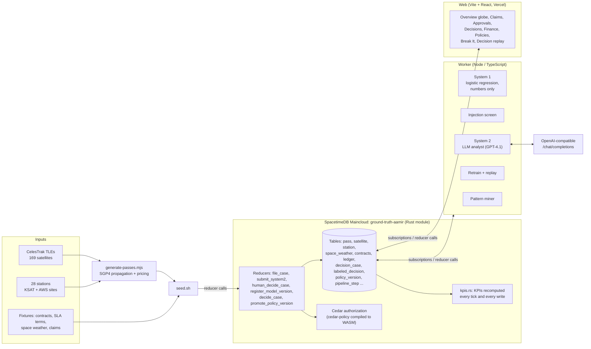
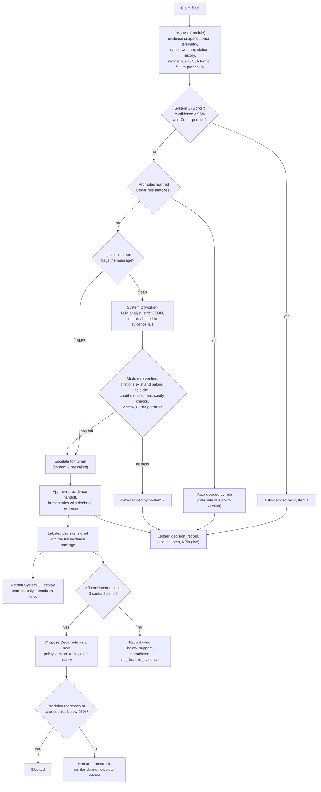

# Ground Truth

**An AI dispute and billing analyst for satellite ground-station operators.** It decides SLA credit claims from orbital, telemetry, space-weather and contract evidence; it decides on its own only when it is at least 95% confident and Cedar policy permits; and it learns new, versioned policy from every human ruling without ever relaxing that gate.

Built for Cal Hacks 2026 by Aamir Abatiyow. Written for judges and sponsors: **Hyphenate**, **SpacetimeDB**, **SpaceX** and **CRS**.

| Live app | What it is |
|---|---|
| [cal-hacks26.vercel.app](https://cal-hacks26.vercel.app) | Main demo |
| [groundtruth-classic.vercel.app](https://groundtruth-classic.vercel.app) | Classic layout |
| [groundtruth-graphs.vercel.app](https://groundtruth-graphs.vercel.app) | Graph-heavy layout |

All three read the same SpacetimeDB Maincloud database, `ground-truth-aamir`, over live subscriptions.

---

## TL;DR

- **Problem.** Ground-station operators bill every satellite pass by the minute, and every dropped or degraded pass can turn into an SLA credit dispute. Reviewing one by hand costs far more than many of the credits being argued over.
- **What it does.** Ground Truth files each claim as a case, builds the evidence from real orbital data, telemetry, space weather and the customer's contract, and routes it through a numbers-only model (System 1), learned Cedar rules, a prompt-injection screen, and an LLM analyst (System 2, GPT-4.1 through any OpenAI-compatible endpoint). The module re-verifies every LLM citation. Anything below 95% confidence goes to a human with a complete evidence package.
- **Hyphenate (deterministic + AI that learns safely).** Human rulings become labeled decisions. After 3 consistent rulings with no contradiction the system proposes a Cedar rule, replays it over the whole labeled history, and blocks it if precision regresses. On a fresh seed, mined policy v6 cut escalations from **2,772 to 1,362** while precision rose from **98.89% to 99.07%** with **0 regressions**. A live ruling then produced **v7**, which is promoted. The four governing rules (the 95% gate, escalation, AI cannot edit policy, human authority) are fixed and cannot be switched off.
- **SpacetimeDB.** The whole decision system (evidence, routing, Cedar authorization, re-verification, ledger, KPIs, audit and replay) runs inside reducers in one Rust module. Every screen updates live through subscriptions, and the worker is just another subscriber.
- **SpaceX.** 169 satellites with real CelesTrak TLEs are SGP4-propagated against 28 real ground-station locations to produce about 49,000 priced passes. A pass-failure classifier is trained on real SatNOGS observations: 0.979 precision on held-out stations (PR [#23](https://github.com/AamirAbatiyow/CalHacks26/pull/23), open).
- **CRS (fraud).** **Break It** fires real adversarial claims through the real decision path from separate identities and reports what was caught, held for a human or missed. Prompt injection: **11 of 12 caught**. Before/after learning (PR [#28](https://github.com/AamirAbatiyow/CalHacks26/pull/28), pending): **29 caught / 45 held / 2 missed** before, **70 / 1 / 5** after one human ruling and v7.

---

## Contents

1. [The problem](#1-the-problem)
2. [The solution](#2-the-solution)
3. [Data: what is real and what is simulated](#3-data-what-is-real-and-what-is-simulated)
4. [Architecture](#4-architecture)
5. [Results and statistics](#5-results-and-statistics)
6. [Running it](#6-running-it)
7. [Sponsor fit](#7-sponsor-fit)
8. [Reference: tables, reducers, KPIs, seed](#8-reference)
9. [Team](#9-team)

---

## 1. The problem

A commercial ground-station network sells antenna time. A satellite flies over a station, the antenna tracks it for a few minutes, and the customer is billed for that contact. We model the operator on **KSAT** (Kongsberg Satellite Services), one of the largest networks, and price contacts at **AWS Ground Station** on-demand rates.

| Fact | Value | Source |
|---|---|---|
| KSAT ground stations | 28 | KSAT 2025 annual report |
| KSAT antennas | ~375 | KSAT 2025 annual report |
| KSAT contacts | ~2.1M per year (~175K per month) | KSAT 2025 annual report |
| KSAT revenue | NOK 2.36B (~$220M) | KSAT 2025 annual report |
| Narrowband price | $15 per minute | AWS Ground Station on-demand |
| Wideband price | $25 per minute | AWS Ground Station on-demand |

Passes fail. Geomagnetic storms degrade high-latitude links, antennas go down for maintenance, and a contact can drop at low elevation. Each failure can become a claim against the customer's SLA, and each claim needs someone to answer three questions: what actually happened to the pass, whether the contract excuses it, and how much credit is owed.

**The economics.** The model assumes a human review costs **$300** and an automated Ground Truth decision costs **$15** (constants in `server/spacetimedb/src/kpis.rs`). A single narrowband contact is often worth well under $300, so reviewing every claim by hand can cost more than paying it. Paying every claim without review invites over-claiming and fraud. On the seeded KSAT-sized operator (fresh seed on `main`):

| Monthly figure (trailing 30 days) | Value |
|---|---|
| Billed | $8.05M |
| Credits paid | $100.9K |
| Revenue at risk | $85.3K |
| Leakage avoided | $96.3K |
| Review cost saved | $180.1K (632 auto-approved decisions x $285) |

Annualized (12x): about **$2.2M** in dispute cost (credits plus revenue at risk), **$1.2M** in leakage avoided and **$2.2M** in review cost saved.

The argument for automation is not "replace the reviewer". It is: let a system decide the cases it can prove, at a confidence it can defend, with an audit trail, and send the reviewer only the genuinely hard cases, with all the evidence already assembled. Then learn from what the reviewer decides.

---

## 2. The solution

Ground Truth is an AI dispute and billing analyst. Each claim becomes a case. The SpacetimeDB module assembles the evidence, the worker proposes decisions, and the module re-verifies them, applies Cedar authorization and writes the final decision, ledger entry and audit record.

### Pages

| Page | What it shows |
|---|---|
| **Overview** | A three.js globe with ground stations, satellites on their real orbits, live pass links and the space-weather auroral oval, plus the KPI strip and a playback bar (1x/4x/16x, scrub the last 24 hours, Live) |
| **Claims** | A claim's disputed pass, its evidence, the gated decision with plain-language reasons, and where the money went |
| **Approvals** | The human queue: every case below 95% confidence, with the full evidence handoff and a decision form |
| **Decisions** | Model versions and retrain latency, learned rules with their Cedar text, the decision audit feed and buttons to file demo claims |
| **Finance** | Summary, **Ledger** (invoices, credits, recoveries and a cumulative credits-vs-recovered chart) and **Audit** (every decision, human or AI; click a row to replay it) tabs |
| **Policies** | Versioned Cedar policies, six months of human audit history, learned-rule proposals, replay of each version over the labeled history, and promotion |
| **Break It** | Adversarial testing: real attack claims filed through the real decision path, scored as caught, held or missed |
| **Settings** | **Show technical details**. Off by default, so the app reads like a billing product (dollars, status, a short reason). On, it reveals confidence, SHAP terms, re-verify checks, model and policy versions, Cedar text and replay internals |

PR [#27](https://github.com/AamirAbatiyow/CalHacks26/pull/27) (open, draft) merges Approvals into a single Claims queue, folds Ledger and Audit under Finance in the sidebar, and adds a G-scale storm overlay and station and satellite info cards to the globe.

### Decision replay

Click any decision (an Audit row, the Claim decision card, or **Replay path** in Approvals) to watch that one decision travel through the pipeline. Only the stages it actually took are drawn, one at a time, each with its output: confidence, the Cedar verdict, the injection screen, the System 2 rationale, re-verify checks, the human's credit, the retrained model version and any policy proposal. Branches not taken show as faint stubs. Built with React Flow (`@xyflow/react`), Motion and dagre.

---

## 3. Data: what is real and what is simulated

| Real | Detail |
|---|---|
| **Satellites** | 169 satellites with real CelesTrak TLEs: 30 curated demo satellites (ISS, NOAA-20 and others; TLE epoch October 2024) plus 139 commercial Earth-observation satellites with current TLEs (Planet 40, ICEYE 40, Spire 30, Satellogic 15, Capella 9, Umbra 5) |
| **Passes** | Propagated with SGP4 (`satellite.js`) against every station. Contacts above 10° elevation lasting at least 4 minutes, booked highest-elevation first under per-satellite quotas, a 5-minute slew gap and each station's antenna count. About 49,000 passes per seed |
| **Ground stations** | 28 real ground-station locations, matching KSAT's reported count of 28: 22 KSAT sites (SvalSat, TrollSat, Tromsø, Inuvik, Hartebeesthoek and others) plus 6 AWS Ground Station regions. 322 antennas in total |
| **Volumes** | Sized against KSAT's 2025 annual report. The seed bills about 47,000 contacts per 30 days (roughly a quarter of KSAT's monthly contacts), about $97M a year against KSAT's ~$220M revenue |
| **Pricing** | AWS Ground Station on-demand: $15/min narrowband, $25/min wideband, billed per started minute |
| **ML training data** | Real SatNOGS observations (3,604 labeled passes from 350 stations), real Kp from GFZ and NOAA SWPC, and SatNOGS DB TLEs. On the PR [#23](https://github.com/AamirAbatiyow/CalHacks26/pull/23) branch |

| Simulated | Detail |
|---|---|
| **Space weather** | A hand-written 24-hour Kp, flare and Dst curve (`server/fixtures/space_weather.json`) with a storm in it |
| **Contracts and SLAs** | Six enterprise contracts and their SLA terms (credit formula, Kp exclusion, maintenance notice period, minimum elevation, filing window) |
| **Drops, disputes and settlement** | Drop rates (1.5%, 6% at stations above 60° latitude during Kp ≥ 5), dispute rates and settlement outcomes are parameters in `server/fixtures/contracts.json` |
| **Ledger, invoices and history** | All money is derived from pass revenue. The six months of human audit decisions (about 10,000 rows from five simulated reviewers, with consistent patterns, contradiction zones and 1% noise) are generated |
| **Telemetry** | The elevation curve is modeled from pass geometry, and per-pass loss is derived deterministically |
| **Incoming claims and customer messages** | Written so the evidence sources disagree in realistic ways (see [Third source](#third-source-sla-contracts-and-customer-messages)) |

On `main`, the module's per-pass failure probability is a fixed logistic proxy (`ml-proxy-0` in `decision_logic.rs`). The SatNOGS-trained classifier is evaluated and packaged on PR [#23](https://github.com/AamirAbatiyow/CalHacks26/pull/23) but not yet wired into the module.

---

## 4. Architecture



### SpacetimeDB module (`server/spacetimedb`, Rust)

The module is the system of record and the decision authority. It owns the evidence, routing, Cedar, every final decision, the ledger, KPIs and audit trail. Published to Maincloud as **`ground-truth-aamir`**.

- **Real-time subscriptions.** The web app and the worker subscribe to the tables they need. When a reducer writes a decision, the Approvals badge, the Audit feed, the ledger, the KPI strip and the decision replay all update together, with no polling and no API layer.
- **Reducers** do all the writes. `file_case` builds a claim's feature snapshot from the pass, telemetry, space weather, 30-day station history and maintenance, SLA terms and the failure probability. `submit_system2` re-verifies the LLM. `human_decide_case` records a labeled ruling. `register_model_version` re-checks a retrained model before promoting it. `promote_policy_version` activates a Cedar version.
- **Cedar authority checks.** `cedar-policy` v4 compiles to `wasm32-unknown-unknown` and runs inside reducers (`authority.rs`, `decision_logic.rs`). Cedar decides whether the AI analyst may auto-approve, and forbids it from editing policy. Learned rules are stored as Cedar text and evaluated alongside the active base policy. Rule conditions are generated from typed values, so they cannot inject Cedar (tested in `rule_conditions_cannot_inject_cedar`).
- **Scheduled reducers** handle SLA deadlines and the Break It injection-run timeout.
- **No dollar caps.** The confidence gate is the only gate: 95% or more auto-decides (if Cedar permits), anything lower escalates.

### Worker (`worker/`, TypeScript)

Reducers cannot call external services, so every model runs in a Node process that subscribes to the decision tables and writes back through reducers. The worker only proposes; the module decides.

- **System 1** (`system1.ts`): L2-regularized logistic regression (warm-started Newton/IRLS) on structured features only. It never sees customer text. It is **retrained live** on every human label (`retrain.ts`; a live label weighs 20 historical ones by default), replayed on the labeled history, and promoted only if auto-approve precision does not regress. The module re-checks this. Measured retrain latency, from human decision to new model registered on the module clock: **43.5 ms** (CLI) and **55 ms** (browser) in PR [#20](https://github.com/AamirAbatiyow/CalHacks26/pull/20), **49 ms** in PR [#21](https://github.com/AamirAbatiyow/CalHacks26/pull/21).
- **System 2** (`system2.ts`): an LLM analyst that reads every evidence source and the customer message. It runs only when System 1 is below 95% and no learned rule matches. GPT-4.1 was used in the live runs (PR [#25](https://github.com/AamirAbatiyow/CalHacks26/pull/25)); any OpenAI-compatible endpoint works. It requests strict JSON-schema output in which `cited_evidence` is an `enum` of this claim's evidence IDs. Without `LLM_API_KEY` it runs a deterministic, deliberately credulous mock, so Break It measures the guards around System 2 rather than the mock.
- **Citation re-verification** (`submit_system2` in the module): every cited evidence row must exist and belong to this claim; the credit cannot exceed the contract entitlement; a completed pass in telemetry or a strong System 1 disagreement forces escalation; then the 95% threshold; then Cedar.

### Prompt-injection defense

The customer message is untrusted input.

1. It never enters the system prompt, which is a constant.
2. It is passed in the user turn as a single JSON-escaped string between `<<<CUSTOMER_MESSAGE>>>` markers, with hidden characters stripped and delimiters neutralized.
3. A screen runs first (`worker/src/screen.ts`): Unicode tag decoding, zero-width and bidi stripping, NFKC normalization, homoglyph folding, base64 decoding and instruction-pattern matching. A flagged message escalates without System 2 ever being called.
4. Whatever System 2 returns is re-verified by the module, and Cedar has the final say.
5. Customer text is never a rule input to the miner.

### Decision flow



### The learning loop

The system never trains on the policies themselves. It learns through two channels.

1. **Model weights.** Every human ruling stores a labeled decision with the full package the reviewer saw: evidence snapshot, customer message and extracted fields, failure probability and SHAP terms, System 1 and System 2 outputs, rules fired, verdict, credit, reason code and text, decisive evidence, reviewer, versions and claim type. System 1 refits on it and is promoted only if replay precision does not regress.
2. **Policy.**
   - A rule is proposed only after **at least 3 consistent rulings** on the same claim type citing the same decisive evidence, with **no contradicting** labeled decision. A single ruling never creates a rule.
   - The rule is written as **Cedar** (`TemplateRuleWriter`, deterministic, with `@id`, `@outcome`, `@confidence` and `@support` annotations) and becomes a new **policy version** linked to the ruling that caused it.
   - It is **replayed over every labeled decision** under the current and proposed policies. Promotion is blocked on any precision regression or any auto-decision below 95%.
   - A human promotes it. New claims that match then auto-decide and cite the rule id and policy version.
   - **Fixed core rules.** Auto-decide at 95%, escalate below 95%, AI cannot edit policies, and human approver authority hold in every version. `toggle_rule` refuses them and the UI shows them as "Fixed".

The `RuleWriter` trait is the seam for an LLM rule writer. Its output would still be parsed by Cedar and replayed before anyone could promote it.

---

## 5. Results and statistics

Every number below comes from a report or PR description in this repository. Seeded figures move slightly with the seed time, because pass geometry and the trailing 30-day window depend on `now`.

### Learning-loop replay (PR [#26](https://github.com/AamirAbatiyow/CalHacks26/pull/26), merged)

Replayed over the labeled human decisions on a fresh seed.

| Policy version | Escalations | Precision | Regressions | Settled automatically | Drift from human credits | Result |
|---|---|---|---|---|---|---|
| v5 (threshold lowered to 90%) | 2,772 → 2,278 | 98.89% → 98.91% | 4 | $54,700 | +$736 | **Blocked** by the 95% floor |
| v6 (7 rules mined from history) | 2,772 → 1,362 | 98.89% → 99.07% | 0 | $129,519 | $0 | Promoted |
| v7 (learned live from CLM-20003) | 1,364 → 1,361 | 99.07% → 99.07% | 0 | $673 | $0 | Promoted, **live** |

The live loop: an approval on CLM-20002 produced no rule (2 of the 3 consistent rulings needed). The same ruling on CLM-20003 made 3 with none contradicting, so v7 was proposed. After promotion, a similar new claim (CLM-20009, TrollSat, Kp 5.0, 95% lost) auto-approved at 99% for $325, citing `v7-learned-1` under policy v7.

The worker's System 1 channel showed the same shape in PR [#20](https://github.com/AamirAbatiyow/CalHacks26/pull/20): CLM-20000 escalated (System 1 85.5%, System 2 85%); a reviewer approved it; `s1-v2` was promoted (precision 95.81% → 95.83%); that ruling was the third consistent one, so rule L4 was mined and promoted (replay precision 96.01% → 96.04%); the similar claim CLM-20001 was then auto-decided by L4.

### Break It: adversarial testing

**Prompt injection (PRs [#20](https://github.com/AamirAbatiyow/CalHacks26/pull/20), [#21](https://github.com/AamirAbatiyow/CalHacks26/pull/21), merged): 11 of 12 caught.**

| Outcome | Count | How |
|---|---|---|
| Blocked by the screen before System 2 ran | 9 | The instruction-style attacks |
| Got through the (credulous) mock, failed module re-verification | 2 | A fabricated citation and a polite false-outage claim |
| Missed | 1 | Social engineering in the uncertain band: the text claims a total outage, telemetry shows a real 18% loss and every structured check passes. Auto-approved for $15.75, capped at the entitlement |

**Before/after learning (PR [#28](https://github.com/AamirAbatiyow/CalHacks26/pull/28): pending, open as a draft and not merged).** Each attack is decided twice through the module's decision path. Local clean reseed, 76 attacks, 27 of them in a storm-overclaim cluster.

| | Caught | Held for a human | Missed | Protected | Bad payouts |
|---|---|---|---|---|---|
| Before (v4, s1-v1) | 29 | 45 | 2 | $217.1K | $164.5K |
| After at seed (v6, s1-v1) | 42 | 31 | 3 | $221.7K | $164.5K |
| After one human ruling + v7 | 70 | 1 | 5 | $226.3K | $164.5K (+$16) |

One ruling (ATK-258, paying the measured loss) proposed v7. In replay over 9,970 labeled decisions, v7 took escalations from 1,362 to 1,359, kept precision at 99.05% and had 0 regressions. Promoting it cleared 29 of the 30 held cluster attacks, which paid $920 instead of the full claims. The two new misses are a duplicate and a recovery claim ($15.99 in total). The bad payouts on both sides are dominated by two insider limit-raise attacks ($164.5K) that the role check lets through; policy learning does not change those.

**History of the score.** An early version reported 50/50 caught, but every attack used a nonexistent station, so one check caught everything. PR [#14](https://github.com/AamirAbatiyow/CalHacks26/pull/14) rebuilt the attacks on real seeded passes and measured an honest **29 of 52 (55.8%)**, listing the gaps it exposed. We kept the lower, real number.

### Pass-failure classifier v3.1.0 (PR [#23](https://github.com/AamirAbatiyow/CalHacks26/pull/23), branch `cursor/final-precision-classifier-9e78`, open)

Gated LightGBM with isotonic calibration on strictly causal physics and outcome-history features (no station id, no satellite target encoding). It auto-decides "pass failed" only when very sure and escalates everything else. Trained on **3,604 labeled real SatNOGS passes from 350 stations** (35 hours, base rate 0.45, 1-hour label lag). Source: `ml/reports/final_v3.md` and `ml/reports/hitl_v3.md` on that branch.

| Split | Auto "failed" calls | Precision | 95% CI (Wilson) | 95% CI (station bootstrap) | Recall | Coverage | Escalated |
|---|---|---|---|---|---|---|---|
| Held-out stations (5 folds) | 380 | **0.979** | 0.959–0.989 | 0.960–0.997 | 22.8% | 10.5% | 87.4% |
| Future time (train 2,145 / test 1,081) | 157 | **0.981** | 0.945–0.993 | 0.950–1.000 | 32.4% | 14.5% | 85.5% |
| Future time, unseen stations | 2 | 1.000 | 0.342–1.000 | – | 12.5% | – | – |

Human-in-the-loop replay (1,442 initial passes, later passes replayed in time order, a ruling arrives 1 hour after each escalated pass):

| Mode | Precision | 95% CI (Wilson) | Mean refit time |
|---|---|---|---|
| Frozen | 0.981 | 0.953–0.993 | – |
| **Warm refit on rulings** | **0.995** | 0.975–0.999 | 0.19 s |
| Full refit on rulings | 0.968 | 0.936–0.985 | 1.28 s |

### KPI volumes (fresh seed on `main`)

| Figure | Value |
|---|---|
| Passes | 48,954 (about 47,000 billed in the trailing 30 days) |
| Billed this month | $8.05M |
| Revenue at risk | $85.3K |
| Credits paid | $100.9K |
| Recovered | $28.7K |
| Leakage avoided | $96.3K |
| Review cost saved | $180.1K (632 auto-approved decisions x $285) |
| Labeled decisions for the worker | 2,409 over 180 days |
| Human audit decisions for the Policies miner | about 10,000 over 182 days |

PR [#27](https://github.com/AamirAbatiyow/CalHacks26/pull/27) (open) rescales the seed with a documented `fleet_multiplier: 10` (Billed $80.6M, Revenue at risk $2.77M, Credits paid $2.67M, Recovered $2.21M). The figures above are the ones on `main`.

### Tests

| Suite | Result on `main` |
|---|---|
| `cargo +stable test` in `server/spacetimedb` | 88 passed |
| `npm test` in `worker` | 34 passed |
| `npm run build` in `web` | passes |
| `pytest ml/tests` (PR #23 branch) | 45 passed |

### Limitations

- **Two learning stacks.** The worker pipeline (`labeled_decision`, `learned_rule`) and the Policies miner (`audit_decision`, `mined_rule`) both mine human rulings into Cedar. Labels from one do not feed the other. They should become one label table and one miner.
- **Optimistic precedent confidence.** A rule's 99% confidence from 3 supporting rulings is optimistic, and replay is in-sample on the same labeled history, with no held-out split for promotion.
- **The failure model on `main` is a proxy.** The SatNOGS classifier is not yet wired into the module, and the elevation curve is modeled.
- **Small ML sample.** 35 hours over two days is a single-season sample. The variant was chosen by comparing on the same folds, so its numbers are slightly optimistic. Unseen-station future-time precision rests on 2 calls. With a 3-hour label lag, held-out precision drops to 0.904.
- **No auto-deny in the base policy.** Confident System 1 denials still go to a human; only learned deny rules auto-deny.
- **Break It gaps it reports itself.** Insider limit raises by admins pass the role check; some duplicates and recovery claims get past the storm rule. The prompt-injection run was scored against the mock System 2.
- **Performance.** Evidence building scans passes and weather in full for each claim.
- **Live-label weight.** One live label weighs 20 historical ones (`LIVE_LABEL_WEIGHT`), which is a judgment call.

---

## 6. Running it

### Prerequisites

- [SpacetimeDB CLI](https://spacetimedb.com/install) 2.13 (`curl -sSf https://install.spacetimedb.com | sh`)
- Node.js 20+, `jq`
- Rust stable (the module uses edition 2024; on older default toolchains use `cargo +stable`)

### Local development

```bash
# 1. Start SpacetimeDB
spacetime start

# 2. Build and publish the module (from the repo root)
spacetime publish ground-truth --server local -p server/spacetimedb -y

# 3. Seed (from the repo root, NOT from server/)
SPACETIMEDB_SERVER=local SPACETIMEDB_MODULE=ground-truth bash server/seed.sh

# 4. Start the decision worker (System 2 runs in mock mode without LLM_API_KEY)
cd worker && npm install && npm run generate && npm start

# 5. Start the web client
cd web && cp .env.example .env && npm install && npm run dev   # http://localhost:5173
```

**Run `spacetime` and `seed.sh` from the repo root.** `server/spacetime.local.json` points any CLI call made inside `server/` at the Maincloud database `ground-truth-aamir`, so running from `server/` would target Maincloud instead of your local database.

`seed.sh` generates the pass history with SGP4 (about 30 s), loads it in batches, settles the dispute and credit history, and seeds SLA terms, maintenance windows, labeled decisions, the six-month audit history and Break It fixtures.

### Maincloud publish and reseed

```bash
spacetime login

# Start the worker against Maincloud first
(cd worker && npm install && npm run generate && \
  STDB_HOST=wss://maincloud.spacetimedb.com STDB_MODULE=ground-truth-aamir npm start)

# In another terminal, from the repo root: republish with a clear (-c deletes all data), then reseed
spacetime publish ground-truth-aamir --server maincloud -p server/spacetimedb -c -y
SPACETIMEDB_SERVER=maincloud SPACETIMEDB_MODULE=ground-truth-aamir bash server/seed.sh
```

Schema changes need a clear-and-reseed. After v7 has been promoted, only a reseed puts the learning demo back in its starting state.

### Worker environment variables

| Variable | Default | Meaning |
|---|---|---|
| `LLM_API_KEY` | unset | Enables the real System 2. Without it, System 2 is the deterministic mock |
| `LLM_MODEL` | `gpt-4o-mini` | Model name, recorded on every System 2 decision. The live demo uses `gpt-4.1` |
| `LLM_BASE_URL` | `https://api.openai.com/v1` | Any OpenAI-compatible `/chat/completions` endpoint |
| `STDB_HOST` | `ws://localhost:3000` | SpacetimeDB host (`wss://maincloud.spacetimedb.com` for Maincloud) |
| `STDB_MODULE` | `ground-truth` | Database name (`ground-truth-aamir` on Maincloud) |
| `LIVE_LABEL_WEIGHT` | `20` | Weight of a live human label relative to one historical label |

### Web environment variables

| Variable | Local | Maincloud |
|---|---|---|
| `VITE_SPACETIMEDB_HOST` | `http://localhost:3000` | `https://maincloud.spacetimedb.com` |
| `VITE_SPACETIMEDB_MODULE` | `ground-truth` | `ground-truth-aamir` |

### Vercel

| Setting | Value |
|---|---|
| Root directory | `web` |
| Framework preset | Vite |
| Build command | `npm run build` |
| Output directory | `dist` |
| Environment | the two Maincloud variables above |

The generated module bindings (`web/src/module_bindings/`) are committed so Vercel builds without the SpacetimeDB CLI. After changing the module, run `npm run generate` in `web/` (and in `worker/`) and commit the result.

### Tests and checks

```bash
(cd server/spacetimedb && cargo +stable test)   # module, Cedar, gate, miner, attacks
(cd worker && npm test)                         # System 1/2, screen, miner, retrain
(cd web && npm run build && npm run lint)
(cd server/scripts && npm install && npm run attacks)   # Break It from separate identities
spacetime logs ground-truth --server local -f
```

---

## 7. Sponsor fit

### Hyphenate: deterministic and AI together, a system that learns, and Cedar as the authority

Ground Truth is built on the idea that an AI should earn autonomy one provable case at a time, and that the rules it earns should be legible, versioned and reversible.

**Deterministic where it must be, AI where it helps.**
- The deterministic layer owns every decision that moves money: the evidence snapshot, the contract entitlement, sanity checks, the 95% gate and Cedar authorization all run inside the SpacetimeDB module.
- The AI layer proposes. System 1 is a numbers-only model that never reads customer text. System 2 is an LLM analyst that reads everything but cannot act: its output is a proposal whose every citation the module re-verifies against real evidence rows, whose credit is capped at the contract entitlement, and which Cedar can still refuse.
- The AI cannot edit policy. That is a Cedar `forbid`, enforced in the reducer, and one of the four fixed rules.

**A self-learning loop with guardrails.**
- Every human ruling is stored as a labeled decision with the full evidence package the reviewer saw and the evidence they marked decisive.
- System 1 retrains on each ruling in tens of milliseconds and is promoted only if replay precision holds.
- Policy is mined, not hand-tuned: 3 consistent rulings and 0 contradictions are required before a rule is even proposed. When the bar is not met, the system says so ("2 of 3 consistent decisions, no rule proposed").
- Every proposal is replayed over the entire labeled history before anyone can promote it. Measured: v5 (a lowered threshold) was **blocked** with 4 regressions; v6 cut escalations **2,772 → 1,362** with precision **98.89% → 99.07%** and 0 regressions; v7 was learned live from one ruling and is the active policy.

**Cedar as the policy language.**
- `cedar-policy` v4 runs inside SpacetimeDB reducers as WASM, so authorization happens in the same transaction as the write it guards.
- Learned rules are real Cedar text with `@id`, `@outcome`, `@confidence` and `@support` annotations, stored per policy version, linked to the human ruling that produced them, and cited by every decision they make.
- Rule conditions are generated from typed values, so mined data cannot inject Cedar.
- The governing rules are fixed in every version. You can watch the policy grow, but you cannot accidentally (or adversarially) turn off the gate.

**Why it matters.** It answers the question every team asks before letting an AI touch money: "what exactly is it allowed to do, why did it do this, and how do we know the new rule did not make things worse?" Decision replay shows the path; the Audit tab shows the versions; Policies shows the replay.

### SpacetimeDB: what only it enables

- **The database is the application server.** Evidence building, routing, Cedar checks, re-verification, ledger writes, KPI recomputation, scheduled SLA deadlines and audit all run in reducers in one Rust module. There is no separate API tier to keep consistent.
- **Real-time everything.** A human ruling in Approvals retrains System 1 in the worker, promotes a model, possibly proposes a policy, and the Audit feed, Decisions page, KPI strip, Policies and decision replay all update live through subscriptions.
- **The AI worker is just another client.** It subscribes to the tables it needs and writes back through reducers. The module stays the authority and the worker can be restarted or replaced.
- **Transactional authorization.** Cedar runs inside the reducer, so a decision and the policy check that permitted it commit together.
- **Event-sourced replay.** Every stage of every decision is a `pipeline_step` row, which is what powers the animated decision replay and the Break It before/after view.
- **Row-level identity.** Break It attackers connect as separate identities with separate roles, and attack claims are owner-scoped.

### SpaceX: real orbital data

- 169 satellites with real CelesTrak TLEs, including commercial constellations (Planet, ICEYE, Spire, Satellogic, Capella, Umbra), are SGP4-propagated against 28 real ground-station locations.
- Passes respect elevation masks, minimum contact length, slew gaps and antenna counts, and are priced at AWS Ground Station rates.
- The pass-failure classifier is trained on real SatNOGS observations with real Kp, with strictly causal features and held-out-station and future-time evaluation (0.979 and 0.981 precision).
- The same billing-dispute problem applies to any operator selling downlink capacity at scale.

### CRS: fraud and Break It

- **Break It** files real adversarial claims (inflated amounts just under thresholds, duplicates outside the window, plausible weather excuses, forged station logs, messy Unicode, insider limit raises, prompt injection) through the real decision path from separate identities.
- It reports misses and bad payouts honestly: we replaced an inflated 50/50 with a measured 29/52 and listed the gaps.
- Prompt injection: 11 of 12 caught, with defense in depth (screen, delimited untrusted input, citation re-verification, entitlement caps, Cedar).
- Learning closes fraud gaps without loosening the gate: in PR [#28](https://github.com/AamirAbatiyow/CalHacks26/pull/28) (pending), one human ruling and v7 moved the attack cluster from 45 held to 1 held, paying measured losses instead of full claims.

---

## 8. Reference

### SpacetimeDB tables (selected)

| Table | Description |
|---|---|
| `station` | Ground station locations and revenue data |
| `satellite` | Satellite catalog with TLE data |
| `pass` | Scheduled, active and completed passes |
| `space_weather` | Kp index, flare events, Dst index |
| `sim_clock` | Simulation time control |
| `kpi` | Financial KPIs, all derived by `sync_kpis`; never written by hand |
| `escalated_claim` | Claims the confidence gate escalated for human review |
| `claim`, `claim_pass`, `claim_evidence`, `claim_decision`, `claim_outcome`, `claim_weather`, `claim_reason` | The Claim page: disputed pass, evidence, gated decision, outcome and SHAP contributions |
| `decision_record` | Audit log for every final decision, with `policy_version` and `model_version` |
| `decision_case`, `case_decision` | The worker pipeline's cases and every step with its deciding system, versions, inputs and cited evidence |
| `labeled_decision`, `model_version`, `learned_rule` | The worker pipeline's labels, System 1 versions and learned Cedar rules |
| `pipeline_step` | One row per stage per decision, keyed `case:<claim_ref>`; powers decision replay |
| `policy_version`, `cedar_rule`, `cedar_policy_store` | Versioned Cedar policies; the active version is the only active store row |
| `audit_decision`, `mined_rule`, `policy_proposal`, `mining_result`, `claim_case` | The Policies miner's six-month history, rules, proposals and mining outcomes |
| `customer_contract`, `claim_message`, `maintenance_log` | The third evidence source: contracts, customer messages and station maintenance |

### Reducers (selected)

| Reducer | Description |
|---|---|
| `seed_station`, `seed_satellite`, `seed_pass`, `seed_passes`, `seed_space_weather` | Load fixture and generated data |
| `settle_pass_history` | Settle the generated history: credits, recoveries, disputes and denials, gated by confidence |
| `set_playback_speed`, `set_playback_playing`, `seek_to_time`, `go_live` | Simulation clock |
| `file_case` | Build a claim's evidence snapshot and start routing |
| `submit_system2` | Re-verify a System 2 proposal, then apply the gate and Cedar |
| `human_decide_case` | Record a human ruling as a labeled decision |
| `register_model_version` | Re-check and promote a retrained System 1 |
| `decide_case` | Policies channel: store a ruling and run the miner |
| `promote_policy_version` | Make a policy version current and activate its Cedar |
| `toggle_rule` | Switch a non-governing rule; refuses the four fixed rules |
| `run_injection_attacks` | File 12 prompt-injection attacks as real claims; refused if the worker has no heartbeat in 15 s, closed by `expire_injection_run` after 60 s |
| `record_decision` | Log a decision with policy and model versions |

### How the KPIs are computed

`server/spacetimedb/src/kpis.rs` recomputes the single `kpi` row every sim tick and after ledger writes, seeding and Approvals decisions.

| KPI | Formula |
|---|---|
| Billed this month | Revenue of every non-scheduled pass that started in the trailing 30 days (dropped passes included) |
| Revenue at risk | Per pass with no credit, recovery or final decision yet: the full revenue of a dropped pass, or the amount of a pending decision or open SLA dispute, capped at the pass's revenue |
| Credits paid | Sum of `Credit` ledger entries |
| Recovered | Sum of `Recovery` ledger entries |
| Leakage avoided | Recovered + denied claim amounts (capped at pass revenue) + denied SLA disputes + the unpaid part of human-reviewed escalations |
| Review cost saved | Auto-approved decisions x ($300 human review - $15 Ground Truth) |

Seeded credits, recoveries and claims are percentages of the revenue of the pass they refer to, and seeded invoices are one per station totalling billed pass revenue.

### Seed inputs (`server/fixtures/`)

| Input | File | Value |
|---|---|---|
| Stations | `stations.json` | 28 stations, 322 antennas (SvalSat 100, Tromsø 40, TrollSat 12, Hartebeesthoek 12, the rest 2 to 10). Monthly revenue is the sum of billed passes |
| Satellites | `satellites.json` | 169 satellites with CelesTrak TLEs; each has a `band` that sets its price |
| Contracts and pricing | `contracts.json` | Six enterprise contracts with daily contact quotas (about 1,580 contacts per day), $15/$25 per started minute, 30 days of history plus 24 hours scheduled |
| Drops and settlement | `contracts.json` | 1.5% drop rate, 6% above 60° latitude during Kp ≥ 5. Passes settle after 72 hours: 60% of drops credited, 25% recovered, the rest denied; 2% of completed passes disputed; 65% of decisions auto-decide |
| SLA terms | `sla_terms.json`, `sla_contracts.json` | Credit formula, Kp exclusion, maintenance notice, minimum elevation, filing window |
| Claims | `claims.json`, `incoming_claims.json` | Escalated claims and the incoming claims with conflicting evidence |
| Space weather | `space_weather.json` | The simulated 24-hour storm curve |

### Third source: SLA contracts and customer messages

Telemetry and space weather say what happened to a pass. They cannot say what it is worth or whether it is excused; that is in the contract. The claim itself arrives as a message that asserts its own version of events. The incoming claims are written so the sources disagree:

| Claim | Disagreement |
|---|---|
| CLM-20002, CLM-20003 | The message blames a geomagnetic storm, but Kp stayed below the Gold contract's exclusion, so the storm does not excuse the provider |
| CLM-20004 | Maintenance was announced, but with less than the contract's notice period |
| CLM-20005 | The customer claims total corruption; telemetry shows 18% lost and the integrity check is pending |
| CLM-20006 | A new account with no history |
| CLM-20007 | Kp was above the exclusion: the contract excuses the loss even though the message asks for credit |
| CLM-20008 | 30% of the contact was lost, but the customer asks for 100% of the fee |

Each conflict lowers confidence by a stated penalty, which is how Approvals explains why a claim is below 95%.

### Repository layout

```
server/spacetimedb   SpacetimeDB Rust module (decision, authority, learning, policy, ledger, KPIs, Break It)
server/fixtures      Seed inputs (stations, satellites, contracts, SLA terms, claims, space weather)
server/scripts       Pass generator (SGP4) and the multi-identity Break It attacker
server/seed.sh       Seeds a database through reducer calls
worker/              System 1, injection screen, System 2, retraining, pattern miner
web/                 Vite + React + TypeScript client (three.js globe, React Flow replay)
```

---

## 9. Team

**Aamir Abatiyow**

## License

MIT
