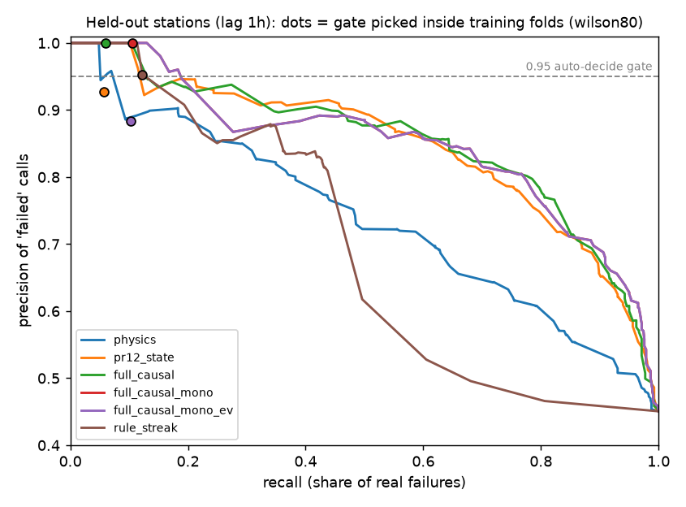
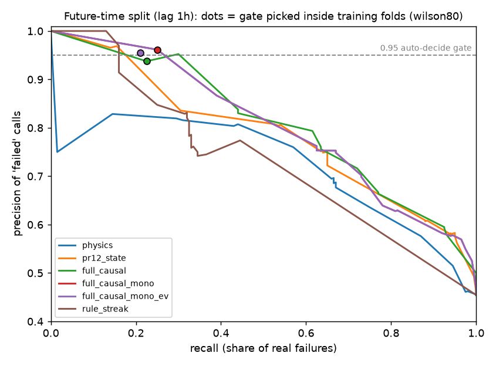

# Final pass-failure classifier (v3): held-out evaluation

Generated 2026-10-24T15:38:39.728345+00:00 by `python -m ml.final_model evaluate`. Main tables use in-fold threshold rule `wilson80` (Wilson lower bound (z=1.2816) of inner OOF precision >= 0.95); the gate threshold is always picked on station-grouped out-of-fold scores *inside the training fold* and then applied once to the test fold. Failure = SatNOGS status `failed` or `bad`. Precision CIs: Wilson (binomial) and station-cluster bootstrap (resampling stations, 1,000 reps). Coverage = share of all test passes auto-decided as failed.

## Label latency 1h

1467 labeled passes with full 1h+6h history coverage (of 3188 stored observations), 304 stations, span 2026-10-21T04:00 to 2026-10-21T14:56 UTC. Status mix: {'good': 806, 'bad': 364, 'failed': 297}.

### Held-out stations (5 station-grouped folds)

| variant | AUC | auto 'failed' calls | precision | 95% CI (Wilson) | 95% CI (station bootstrap) | recall (all failures) | recall failed / bad | coverage | OK side: precision / coverage | accuracy on auto-decided (both sides) |
|---|---|---|---|---|---|---|---|---|---|---|
| physics | 0.775 | 0 | – | – | – | 0.0% | 0.0% / 0.0% | 0.0% | – / 0.0% | – |
| pr12_state | 0.873 | 41 | 0.927 | 0.806–0.975 | 0.812–1.000 | 5.7% | 10.1% / 2.2% | 2.8% | 0.880 / 1.7% | 0.909 |
| full_causal | 0.878 | 40 | 1.000 | 0.912–1.000 | 1.000–1.000 | 6.1% | 12.5% / 0.8% | 2.7% | 0.919 / 2.5% | 0.961 |
| full_causal_mono | 0.881 | 70 | 1.000 | 0.948–1.000 | 1.000–1.000 | 10.6% | 19.9% / 3.0% | 4.8% | 0.891 / 3.7% | 0.952 |
| full_causal_mono_ev | 0.881 | 77 | 0.883 | 0.793–0.937 | 0.766–1.000 | 10.3% | 20.2% / 2.2% | 5.2% | 0.891 / 3.7% | 0.886 |
| rule_streak | 0.685 | 85 | 0.953 | 0.885–0.982 | 0.843–1.000 | 12.3% | 25.9% / 1.1% | 5.8% | – / 0.0% | 0.953 |

### Future time (train first 70%, 3h embargo)

| variant | AUC | auto 'failed' calls | precision | 95% CI (Wilson) | 95% CI (station bootstrap) | recall (all failures) | recall failed / bad | coverage | OK side: precision / coverage | accuracy on auto-decided (both sides) |
|---|---|---|---|---|---|---|---|---|---|---|
| physics | 0.774 | 0 | – | – | – | 0.0% | 0.0% / 0.0% | 0.0% | – / 0.0% | – |
| pr12_state | 0.814 | 0 | – | – | – | 0.0% | 0.0% / 0.0% | 0.0% | – / 0.0% | – |
| full_causal | 0.827 | 48 | 0.938 | 0.832–0.979 | 0.848–1.000 | 22.5% | 40.7% / 10.1% | 10.9% | – / 0.0% | 0.938 |
| full_causal_mono | 0.819 | 52 | 0.962 | 0.870–0.989 | 0.896–1.000 | 25.0% | 45.7% / 10.9% | 11.8% | – / 0.0% | 0.962 |
| full_causal_mono_ev | 0.819 | 44 | 0.955 | 0.849–0.987 | 0.884–1.000 | 21.0% | 44.4% / 5.0% | 10.0% | – / 0.0% | 0.955 |
| rule_streak | 0.680 | 0 | – | – | – | 0.0% | 0.0% / 0.0% | 0.0% | – / 0.0% | – |

Future time, test stations never seen in training:

| variant | n | auto 'failed' calls | precision | 95% CI (Wilson) | recall |
|---|---|---|---|---|---|
| physics | 89 | 0 | – | – | 0.0% |
| pr12_state | 89 | 0 | – | – | 0.0% |
| full_causal | 89 | 2 | 0.500 | 0.095–0.905 | 3.4% |
| full_causal_mono | 89 | 2 | 0.500 | 0.095–0.905 | 3.4% |
| full_causal_mono_ev | 89 | 2 | 0.500 | 0.095–0.905 | 3.4% |
| rule_streak | 89 | 0 | – | – | 0.0% |

### In-fold threshold rule comparison (failed side)

| variant | rule | held-out stations: calls / precision (Wilson CI) / recall | future time: calls / precision (Wilson CI) / recall |
|---|---|---|---|
| physics | wilson95 | 0 / – (–) / 0.0% | 0 / – (–) / 0.0% |
| physics | wilson80 | 0 / – (–) / 0.0% | 0 / – (–) / 0.0% |
| physics | point97 | 20 / 1.000 (0.839–1.000) / 3.0% | 0 / – (–) / 0.0% |
| physics | point95 | 22 / 0.955 (0.782–0.992) / 3.2% | 0 / – (–) / 0.0% |
| pr12_state | wilson95 | 0 / – (–) / 0.0% | 0 / – (–) / 0.0% |
| pr12_state | wilson80 | 41 / 0.927 (0.806–0.975) / 5.7% | 0 / – (–) / 0.0% |
| pr12_state | point97 | 89 / 0.921 (0.846–0.961) / 12.4% | 29 / 0.966 (0.828–0.994) / 14.0% |
| pr12_state | point95 | 128 / 0.922 (0.862–0.957) / 17.9% | 34 / 0.971 (0.851–0.995) / 16.5% |
| full_causal | wilson95 | 12 / 1.000 (0.757–1.000) / 1.8% | 0 / – (–) / 0.0% |
| full_causal | wilson80 | 40 / 1.000 (0.912–1.000) / 6.1% | 48 / 0.938 (0.832–0.979) / 22.5% |
| full_causal | point97 | 91 / 0.956 (0.892–0.983) / 13.2% | 63 / 0.952 (0.869–0.984) / 30.0% |
| full_causal | point95 | 131 / 0.924 (0.865–0.958) / 18.3% | 64 / 0.953 (0.871–0.984) / 30.5% |
| full_causal_mono | wilson95 | 12 / 1.000 (0.757–1.000) / 1.8% | 0 / – (–) / 0.0% |
| full_causal_mono | wilson80 | 70 / 1.000 (0.948–1.000) / 10.6% | 52 / 0.962 (0.870–0.989) / 25.0% |
| full_causal_mono | point97 | 101 / 0.980 (0.931–0.995) / 15.0% | 54 / 0.963 (0.875–0.990) / 26.0% |
| full_causal_mono | point95 | 139 / 0.914 (0.855–0.950) / 19.2% | 58 / 0.966 (0.883–0.990) / 28.0% |
| full_causal_mono_ev | wilson95 | 47 / 0.979 (0.889–0.996) / 7.0% | 0 / – (–) / 0.0% |
| full_causal_mono_ev | wilson80 | 77 / 0.883 (0.793–0.937) / 10.3% | 44 / 0.955 (0.849–0.987) / 21.0% |
| full_causal_mono_ev | point97 | 107 / 0.916 (0.848–0.955) / 14.8% | 58 / 0.897 (0.792–0.952) / 26.0% |
| full_causal_mono_ev | point95 | 145 / 0.890 (0.828–0.931) / 19.5% | 72 / 0.861 (0.763–0.923) / 31.0% |
| rule_streak | wilson95 | 0 / – (–) / 0.0% | 0 / – (–) / 0.0% |
| rule_streak | wilson80 | 85 / 0.953 (0.885–0.982) / 12.3% | 0 / – (–) / 0.0% |
| rule_streak | point97 | 85 / 0.953 (0.885–0.982) / 12.3% | 44 / 0.909 (0.788–0.964) / 20.0% |
| rule_streak | point95 | 102 / 0.941 (0.878–0.973) / 14.5% | 44 / 0.909 (0.788–0.964) / 20.0% |

Per-fold precision of `full_causal_mono` on held-out stations (wilson80): 1.000 (n=25), 1.000 (n=28), – (n=0), 1.000 (n=16), 1.000 (n=1)

## Label latency 3h

1216 labeled passes with full 3h+6h history coverage (of 3188 stored observations), 288 stations, span 2026-10-21T06:01 to 2026-10-21T14:56 UTC. Status mix: {'good': 675, 'bad': 293, 'failed': 248}.

### Held-out stations (5 station-grouped folds)

| variant | AUC | auto 'failed' calls | precision | 95% CI (Wilson) | 95% CI (station bootstrap) | recall (all failures) | recall failed / bad | coverage | OK side: precision / coverage | accuracy on auto-decided (both sides) |
|---|---|---|---|---|---|---|---|---|---|---|
| physics | 0.777 | 0 | – | – | – | 0.0% | 0.0% / 0.0% | 0.0% | – / 0.0% | – |
| pr12_state | 0.846 | 10 | 1.000 | 0.722–1.000 | 1.000–1.000 | 1.8% | 2.4% / 1.4% | 0.8% | 1.000 / 0.1% | 1.000 |
| full_causal | 0.853 | 8 | 0.875 | 0.529–0.978 | 0.500–1.000 | 1.3% | 0.4% / 2.0% | 0.7% | 0.939 / 2.7% | 0.927 |
| full_causal_mono | 0.855 | 17 | 0.941 | 0.730–0.990 | 0.714–1.000 | 3.0% | 3.2% / 2.7% | 1.4% | 1.000 / 0.2% | 0.947 |
| full_causal_mono_ev | 0.855 | 36 | 0.917 | 0.782–0.971 | 0.812–1.000 | 6.1% | 11.3% / 1.7% | 3.0% | 1.000 / 0.2% | 0.921 |
| rule_streak | 0.645 | 28 | 0.750 | 0.566–0.873 | 0.650–1.000 | 3.9% | 5.6% / 2.4% | 2.3% | – / 0.0% | 0.750 |

### Future time (train first 70%, 3h embargo)

| variant | AUC | auto 'failed' calls | precision | 95% CI (Wilson) | 95% CI (station bootstrap) | recall (all failures) | recall failed / bad | coverage | OK side: precision / coverage | accuracy on auto-decided (both sides) |
|---|---|---|---|---|---|---|---|---|---|---|
| physics | 0.739 | 0 | – | – | – | 0.0% | 0.0% / 0.0% | 0.0% | – / 0.0% | – |
| pr12_state | 0.763 | 0 | – | – | – | 0.0% | 0.0% / 0.0% | 0.0% | – / 0.0% | – |
| full_causal | 0.804 | 0 | – | – | – | 0.0% | 0.0% / 0.0% | 0.0% | – / 0.0% | – |
| full_causal_mono | 0.800 | 0 | – | – | – | 0.0% | 0.0% / 0.0% | 0.0% | – / 0.0% | – |
| full_causal_mono_ev | 0.800 | 0 | – | – | – | 0.0% | 0.0% / 0.0% | 0.0% | – / 0.0% | – |
| rule_streak | 0.644 | 0 | – | – | – | 0.0% | 0.0% / 0.0% | 0.0% | – / 0.0% | – |

Future time, test stations never seen in training:

| variant | n | auto 'failed' calls | precision | 95% CI (Wilson) | recall |
|---|---|---|---|---|---|
| physics | 108 | 0 | – | – | 0.0% |
| pr12_state | 108 | 0 | – | – | 0.0% |
| full_causal | 108 | 0 | – | – | 0.0% |
| full_causal_mono | 108 | 0 | – | – | 0.0% |
| full_causal_mono_ev | 108 | 0 | – | – | 0.0% |
| rule_streak | 108 | 0 | – | – | 0.0% |

### In-fold threshold rule comparison (failed side)

| variant | rule | held-out stations: calls / precision (Wilson CI) / recall | future time: calls / precision (Wilson CI) / recall |
|---|---|---|---|
| physics | wilson95 | 0 / – (–) / 0.0% | 0 / – (–) / 0.0% |
| physics | wilson80 | 0 / – (–) / 0.0% | 0 / – (–) / 0.0% |
| physics | point97 | 5 / 1.000 (0.566–1.000) / 0.9% | 7 / 0.714 (0.359–0.918) / 3.0% |
| physics | point95 | 5 / 1.000 (0.566–1.000) / 0.9% | 7 / 0.714 (0.359–0.918) / 3.0% |
| pr12_state | wilson95 | 0 / – (–) / 0.0% | 0 / – (–) / 0.0% |
| pr12_state | wilson80 | 10 / 1.000 (0.722–1.000) / 1.8% | 0 / – (–) / 0.0% |
| pr12_state | point97 | 52 / 0.981 (0.899–0.997) / 9.4% | 19 / 0.842 (0.624–0.945) / 9.6% |
| pr12_state | point95 | 82 / 0.963 (0.898–0.987) / 14.6% | 51 / 0.863 (0.743–0.932) / 26.3% |
| full_causal | wilson95 | 0 / – (–) / 0.0% | 0 / – (–) / 0.0% |
| full_causal | wilson80 | 8 / 0.875 (0.529–0.978) / 1.3% | 0 / – (–) / 0.0% |
| full_causal | point97 | 31 / 0.903 (0.751–0.967) / 5.2% | 22 / 0.909 (0.722–0.975) / 12.0% |
| full_causal | point95 | 49 / 0.918 (0.808–0.968) / 8.3% | 36 / 0.889 (0.747–0.956) / 19.2% |
| full_causal_mono | wilson95 | 0 / – (–) / 0.0% | 0 / – (–) / 0.0% |
| full_causal_mono | wilson80 | 17 / 0.941 (0.730–0.990) / 3.0% | 0 / – (–) / 0.0% |
| full_causal_mono | point97 | 28 / 0.964 (0.823–0.994) / 5.0% | 16 / 0.938 (0.717–0.989) / 9.0% |
| full_causal_mono | point95 | 53 / 0.962 (0.872–0.990) / 9.4% | 70 / 0.843 (0.740–0.910) / 35.3% |
| full_causal_mono_ev | wilson95 | 0 / – (–) / 0.0% | 0 / – (–) / 0.0% |
| full_causal_mono_ev | wilson80 | 36 / 0.917 (0.782–0.971) / 6.1% | 0 / – (–) / 0.0% |
| full_causal_mono_ev | point97 | 72 / 0.903 (0.813–0.952) / 12.0% | 8 / 1.000 (0.676–1.000) / 4.8% |
| full_causal_mono_ev | point95 | 100 / 0.890 (0.814–0.937) / 16.5% | 8 / 1.000 (0.676–1.000) / 4.8% |
| rule_streak | wilson95 | 0 / – (–) / 0.0% | 0 / – (–) / 0.0% |
| rule_streak | wilson80 | 28 / 0.750 (0.566–0.873) / 3.9% | 0 / – (–) / 0.0% |
| rule_streak | point97 | 50 / 0.860 (0.738–0.930) / 7.9% | 24 / 0.792 (0.595–0.908) / 11.4% |
| rule_streak | point95 | 75 / 0.907 (0.820–0.954) / 12.6% | 32 / 0.844 (0.682–0.931) / 16.2% |

Per-fold precision of `full_causal_mono` on held-out stations (wilson80): 1.000 (n=9), – (n=0), – (n=0), – (n=0), 0.875 (n=8)

