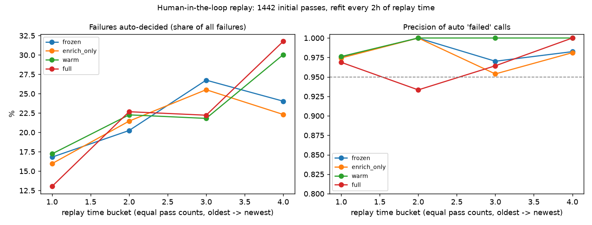

# Human-in-the-loop replay (v3)

Generated 2026-10-24T18:08:29.717503+00:00 by `python -m ml.hitl simulate`. Initial model trained on 1442 passes before 2026-10-21T00:16 UTC; later passes are replayed in time order. Every escalated pass gets its true SatNOGS label as the human ruling 1h after the pass ends. Refit every 2h of replay time.

- `frozen`: no updates.
- `enrich_only`: rulings only make outcomes known earlier to the history features; model unchanged.
- `warm`: enrich + continued boosting on rulings (+ replay sample), gate re-aligned to the same flagged share.
- `full`: enrich + nested refit (inner station-grouped OOF -> isotonic + Wilson 0.95 threshold).

| mode | auto 'failed' calls | precision | 95% CI (Wilson) | failures auto-decided | `failed` class auto-decided | escalated | human labels | refits | mean refit time |
|---|---|---|---|---|---|---|---|---|---|
| frozen | 215 | 0.981 | 0.953–0.993 | 22.0% | 32.1% | 90.1% | 0 | 0 | –s |
| enrich_only | 210 | 0.976 | 0.945–0.990 | 21.3% | 31.4% | 90.3% | 0 | 0 | –s |
| warm | 220 | 0.995 | 0.975–0.999 | 22.8% | 35.0% | 89.8% | 1756 | 8 | 0.19s |
| full | 222 | 0.968 | 0.936–0.985 | 22.4% | 35.8% | 88.6% | 1741 | 8 | 1.28s |

Failures auto-decided per replay bucket (equal pass counts, oldest first); precision in brackets:

| mode | b1 | b2 | b3 | b4 |
|---|---|---|---|---|
| frozen | 16.8% (0.98, n=41) | 20.2% (1.00, n=50) | 26.7% (0.97, n=67) | 24.0% (0.98, n=57) |
| enrich_only | 16.0% (0.97, n=39) | 21.5% (1.00, n=53) | 25.5% (0.95, n=65) | 22.3% (0.98, n=53) |
| warm | 17.2% (0.98, n=42) | 22.3% (1.00, n=55) | 21.8% (1.00, n=53) | 30.0% (1.00, n=70) |
| full | 13.0% (0.97, n=32) | 22.7% (0.93, n=60) | 22.2% (0.96, n=56) | 31.8% (1.00, n=74) |

