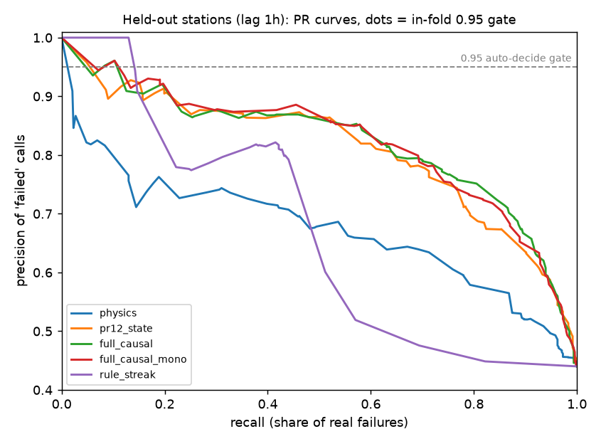
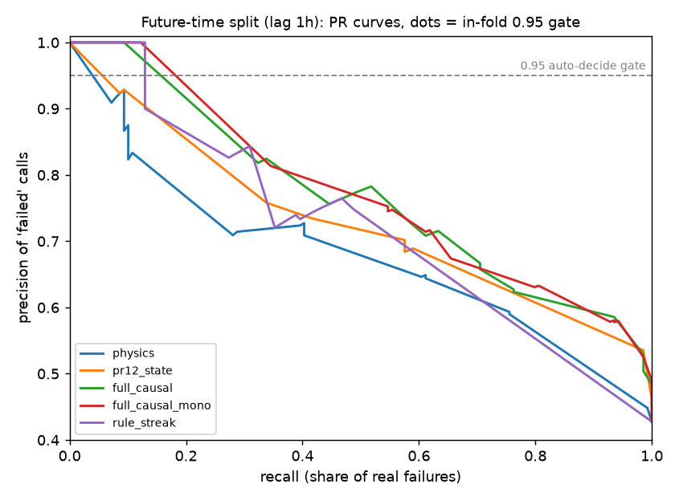

# Final pass-failure classifier (v3): held-out evaluation

Generated 2026-10-24T15:18:24.443462+00:00 by `python -m ml.final_model evaluate`. Threshold rule inside each training fold: `wilson` (Wilson 95% lower bound of inner out-of-fold precision >= 0.95). Failure = SatNOGS status `failed` or `bad`. Precision CI: Wilson (binomial) and station-cluster bootstrap (resampling stations).

## Label latency 1h

1084 labeled passes with full 1h+6h history coverage (of 2735 stored observations, all statuses), 276 stations, span 2026-10-21T07:00 to 2026-10-21T14:56 UTC. Status mix: {'good': 607, 'bad': 261, 'failed': 216}.

### Held-out stations (5 station-grouped folds)

| variant | AUC | auto 'failed' calls | precision | 95% CI (Wilson) | 95% CI (station bootstrap) | recall (all failures) | recall failed / bad | coverage | OK-side precision / coverage | accuracy on auto-decided (two-sided) |
|---|---|---|---|---|---|---|---|---|---|---|
| physics | 0.769 | 0 | – | – | – | 0.0% | 0.0% / 0.0% | 0.0% | – / 0.0% | – |
| pr12_state | 0.857 | 0 | – | – | – | 0.0% | 0.0% / 0.0% | 0.0% | – / 0.0% | – |
| full_causal | 0.866 | 0 | – | – | – | 0.0% | 0.0% / 0.0% | 0.0% | – / 0.0% | – |
| full_causal_mono | 0.866 | 0 | – | – | – | 0.0% | 0.0% / 0.0% | 0.0% | – / 0.0% | – |
| rule_streak | 0.683 | 0 | – | – | – | 0.0% | 0.0% / 0.0% | 0.0% | – / 0.0% | – |

### Future time (train first 70%, 3h embargo)

| variant | AUC | auto 'failed' calls | precision | 95% CI (Wilson) | 95% CI (station bootstrap) | recall (all failures) | recall failed / bad | coverage | OK-side precision / coverage | accuracy on auto-decided (two-sided) |
|---|---|---|---|---|---|---|---|---|---|---|
| physics | 0.759 | 0 | – | – | – | 0.0% | 0.0% / 0.0% | 0.0% | – / 0.0% | – |
| pr12_state | 0.806 | 0 | – | – | – | 0.0% | 0.0% / 0.0% | 0.0% | – / 0.0% | – |
| full_causal | 0.818 | 0 | – | – | – | 0.0% | 0.0% / 0.0% | 0.0% | – / 0.0% | – |
| full_causal_mono | 0.815 | 0 | – | – | – | 0.0% | 0.0% / 0.0% | 0.0% | – / 0.0% | – |
| rule_streak | 0.690 | 0 | – | – | – | 0.0% | 0.0% / 0.0% | 0.0% | – / 0.0% | – |

Future time, stations never seen in training:

| variant | n | auto 'failed' calls | precision | 95% CI (Wilson) | recall |
|---|---|---|---|---|---|
| physics | 118 | 0 | – | – | 0.0% |
| pr12_state | 118 | 0 | – | – | 0.0% |
| full_causal | 118 | 0 | – | – | 0.0% |
| full_causal_mono | 118 | 0 | – | – | 0.0% |
| rule_streak | 118 | 0 | – | – | 0.0% |

Per-fold precision of `full_causal_mono` on held-out stations: – (n=0), – (n=0), – (n=0), – (n=0), – (n=0)

## Label latency 3h

852 labeled passes with full 3h+6h history coverage (of 2735 stored observations, all statuses), 255 stations, span 2026-10-21T09:00 to 2026-10-21T14:56 UTC. Status mix: {'good': 474, 'bad': 207, 'failed': 171}.

### Held-out stations (5 station-grouped folds)

| variant | AUC | auto 'failed' calls | precision | 95% CI (Wilson) | 95% CI (station bootstrap) | recall (all failures) | recall failed / bad | coverage | OK-side precision / coverage | accuracy on auto-decided (two-sided) |
|---|---|---|---|---|---|---|---|---|---|---|
| physics | 0.751 | 0 | – | – | – | 0.0% | 0.0% / 0.0% | 0.0% | – / 0.0% | – |
| pr12_state | 0.816 | 0 | – | – | – | 0.0% | 0.0% / 0.0% | 0.0% | – / 0.0% | – |
| full_causal | 0.829 | 0 | – | – | – | 0.0% | 0.0% / 0.0% | 0.0% | – / 0.0% | – |
| full_causal_mono | 0.827 | 0 | – | – | – | 0.0% | 0.0% / 0.0% | 0.0% | – / 0.0% | – |
| rule_streak | 0.646 | 0 | – | – | – | 0.0% | 0.0% / 0.0% | 0.0% | – / 0.0% | – |

### Future time (train first 70%, 3h embargo)

| variant | AUC | auto 'failed' calls | precision | 95% CI (Wilson) | 95% CI (station bootstrap) | recall (all failures) | recall failed / bad | coverage | OK-side precision / coverage | accuracy on auto-decided (two-sided) |
|---|---|---|---|---|---|---|---|---|---|---|
| physics | 0.586 | 0 | – | – | – | 0.0% | 0.0% / 0.0% | 0.0% | – / 0.0% | – |
| pr12_state | 0.638 | 0 | – | – | – | 0.0% | 0.0% / 0.0% | 0.0% | – / 0.0% | – |
| full_causal | 0.698 | 0 | – | – | – | 0.0% | 0.0% / 0.0% | 0.0% | – / 0.0% | – |
| full_causal_mono | 0.698 | 0 | – | – | – | 0.0% | 0.0% / 0.0% | 0.0% | – / 0.0% | – |
| rule_streak | 0.636 | 0 | – | – | – | 0.0% | 0.0% / 0.0% | 0.0% | – / 0.0% | – |

Future time, stations never seen in training:

| variant | n | auto 'failed' calls | precision | 95% CI (Wilson) | recall |
|---|---|---|---|---|---|
| physics | 112 | 0 | – | – | 0.0% |
| pr12_state | 112 | 0 | – | – | 0.0% |
| full_causal | 112 | 0 | – | – | 0.0% |
| full_causal_mono | 112 | 0 | – | – | 0.0% |
| rule_streak | 112 | 0 | – | – | 0.0% |

Per-fold precision of `full_causal_mono` on held-out stations: – (n=0), – (n=0), – (n=0), – (n=0), – (n=0)

